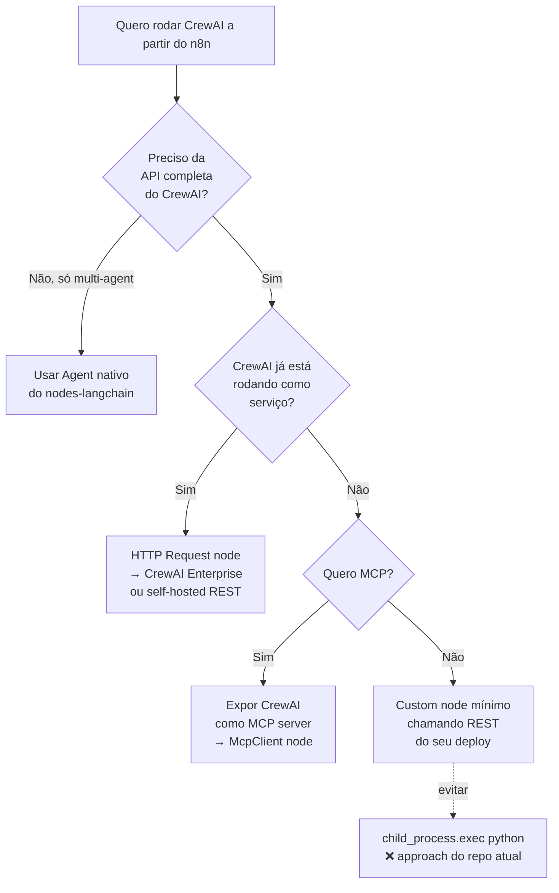

# n8n-nodes-crewai — vale a pena continuar?

**TL;DR:** Não continuar como está. Repo é WIP de abril/2024, parou no meio do mapeamento de parâmetros, e a arquitetura (Node TS faz `child_process.exec("python …")`) não é viável para publicar como community node. CrewAI e n8n evoluíram muito desde então — o nicho que esse repo tentava ocupar **já é coberto** por duas vias melhores.

---

## 1. Estado atual do repo

`github.com/biliboss/n8n-nodes-crewai` (branch `main`):

| Item | Estado |
|---|---|
| Versão | `0.1.0`, derivado de `n8n-nodes-starter` |
| Nodes declarados | `Crew`, `Agent`, `Task`, `ExampleNode`, `HttpBin` |
| Mecanismo de execução | `child_process.exec("python python/n8n-crewai.py --json …")` em `nodes/Crew/Crew.node.ts:101` |
| Python alvo | CrewAI + `langchain_openai`, hardcoded `gpt-3.5-turbo-0125`, `api_key=""` |
| README TODOs incompletos | Map params → script; configurar credentials; versionamento; guidelines de community node |
| Last package fields | `author`, `homepage`, `repository.url` ainda placeholders |

**Sintomas de protótipo abandonado:**
- `index.js` vazio (0 B).
- `sample.py` com 21 B (stub).
- Sem CI, sem testes, sem `.gitignore` apontando `dist`.
- `n8n-core` / `n8n-workflow` em `*` (sem versão pinada).
- `package-lock.json` **e** `pnpm-lock.yaml` coexistem.

## 2. O que mudou em CrewAI desde abril/2024

Inspecionando `crewAIInc/crewAI@main` (`lib/crewai/src/crewai/`):

```
a2a/  agent/  agents/  cli/  core/  crews/  events/  experimental/
flow/  hooks/  knowledge/  llms/  mcp/  memory/  project/  rag/
security/  skills/  state/  tasks/  telemetry/  tools/  types/
```

Em 2024 o repo do user lidava com `Agent + Task + Crew` apenas (~3 classes). Hoje CrewAI é um framework com:

- **Flow** (orquestração além de Crew).
- **Knowledge / RAG** nativos.
- **MCP client** (`crewai/mcp/client.py`, 27 KB) — fala protocolo MCP direto.
- **A2A** (agent-to-agent).
- **Memory unificada**, hooks de LLM, telemetry, security/auth.

Mapear isso tudo via JSON serializado no `--json` da CLI Python é inviável.

## 3. O que mudou em n8n desde abril/2024

`n8n-io/n8n@master/packages/@n8n/nodes-langchain/nodes/`:

```
Agent/  agents/  chains/  embeddings/  llms/  mcp/  memory/
ModelSelector/  rerankers/  retrievers/  text_splitters/
ToolExecutor/  tools/  trigger/  vector_store/  Guardrails/  …
```

Destaque:

- **`Agent/`** — nó de agente LLM com tools, memory, output parsers (cobre 80% do caso de uso de "rodar agente autônomo").
- **`mcp/McpClient`, `McpClientTool`, `McpRegistryClientTool`, `McpTrigger`** — n8n hoje fala MCP nativamente.
- **`ToolExecutor`** — chama tools arbitrárias dentro de workflows.

Ou seja: o caso de uso "agente autônomo dentro de n8n" foi absorvido pelo `nodes-langchain` oficial.

## 4. Caminhos alternativos (ranqueados)



| Opção | Esforço | Manutenção | Recomendado quando |
|---|---|---|---|
| **A. Agent node nativo** (`@n8n/nodes-langchain/Agent`) | Zero | n8n core | Caso de uso multi-agent simples. Provavelmente suficiente. |
| **B. CrewAI como serviço + HTTP Request** | Baixo | Você só mantém o serviço Python, não o node | Precisa de Flow/Knowledge/RAG do CrewAI |
| **C. CrewAI como MCP server + McpClient** | Médio | Padrão MCP cuida do contrato | Quer que outros agentes/clientes também consumam |
| **D. Custom node TS chamando REST** | Médio | Você mantém o node | Quer UX nativa no editor (typed params) |
| **E. Continuar o repo atual (exec python)** | Alto | Alta — frágil, blocking, sem stream | **Não recomendado** |

## 5. Por que não publicar como community node

Olhando `nodes/Crew/Crew.node.ts`:

```ts
const execPromise = promisify(exec);
// …
const cmd = `python python/n8n-crewai.py --json ${jsonParams}`;
await execPromise(cmd);
```

Problemas estruturais para registry da n8n:

1. **Assume Python no host** — community nodes rodam em Docker/Cloud n8n; Python não está garantido.
2. **Shell injection surface** — interpolação de JSON em string de shell.
3. **Sem streaming** — `exec` é blocking, sem token streaming, sem cancel.
4. **Sem credentials propagation** — `api_key=""` hardcoded no `.py`.
5. **`n8n-core: "*"`** — quebra em qualquer breaking change upstream.
6. **Sem suporte a tools/memory** — o `interface.ts` tem 100 B.

> [!WARNING]
> n8n community node guidelines exigem self-contained JS/TS, declared credentials, sem deps de runtime externo. O approach atual reprova nesses três pontos.

## 6. Recomendação

**Parar com este repo.** Em ordem de preferência:

1. **Se você quer agentes no n8n** → usar `Agent` + `tools` + `memory` do `@n8n/nodes-langchain`. Zero código.
2. **Se você quer especificamente CrewAI** (Flow, Knowledge) → subir CrewAI como serviço (FastAPI ou CrewAI Enterprise) e chamar via **HTTP Request node**. Sem custom node.
3. **Se você quer integração com outros agentes/clients** → expor o CrewAI como **MCP server** e consumir via `McpClient` node.
4. **Só faça custom node se** a UX de parâmetros tipados no editor do n8n for requisito de produto — nesse caso, comece do zero com REST, não com `exec python`.

> [!TIP]
> O repo serviu como POC de que dá pra acoplar — esse aprendizado já foi capturado. Arquivar (`README` com "superseded by …") preserva histórico sem confundir futuros forks.

## 7. Se mesmo assim quiser continuar

Mínimos não-negociáveis antes de retomar:

- [ ] Trocar `child_process.exec` por chamada HTTP a um serviço CrewAI.
- [ ] Declarar `CrewAIApi` credential (api key, base URL).
- [ ] Pinar `n8n-workflow` / `n8n-core` em versões reais.
- [ ] Remover `ExampleNode` e `HttpBin` boilerplate.
- [ ] Decidir 1 lockfile (pnpm, conforme seu padrão global) e remover o outro.
- [ ] Mapear apenas Agent/Task/Crew estáveis; ignorar Flow/A2A até primeira release.
- [ ] Testes E2E com `n8n start` local.

## 8. Referências (source-of-truth lidas)

- `biliboss/n8n-nodes-crewai@main/nodes/Crew/Crew.node.ts` — execução via `exec`
- `biliboss/n8n-nodes-crewai@main/python/n8n-crewai.py` — bridge Python
- `crewAIInc/crewAI@main/lib/crewai/src/crewai/` — escopo atual do framework
- `crewAIInc/crewAI@main/lib/crewai/src/crewai/mcp/client.py` — MCP nativo
- `n8n-io/n8n@master/packages/@n8n/nodes-langchain/nodes/Agent` — substituto direto
- `n8n-io/n8n@master/packages/@n8n/nodes-langchain/nodes/mcp/` — ponte MCP
