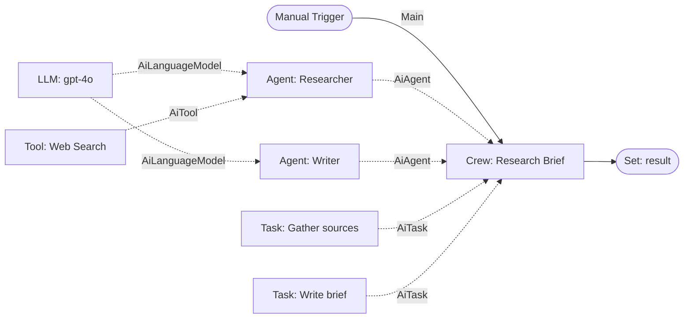

# ADR-002: Node Taxonomy — Mapping CrewAI Concepts to n8n Nodes

- **Status:** Accepted (visual-first milestone, branch `v2-visual-first`)
- **Date:** 2026-05-20
- **Deciders:** @biliboss
- **Supersedes:** —
- **Related:** ADR-001 (visual-first direction)

## Context

We are building `n8n-nodes-crewai`, a community node package that exposes the
[CrewAI](https://github.com/crewAIInc/crewAI) Python framework's semantics as
first-class objects on the n8n canvas. The visual-first thesis is that a user
should *see* a crew the same way they read a CrewAI YAML/Python file: agents,
their tools, their LLMs, and the tasks they execute.

n8n's `@n8n/nodes-langchain` package already establishes the canonical pattern
for "composite AI nodes": a **main node** sits on the workflow (orchestrator)
and accepts **sub-nodes** through typed AI connections (e.g. `AiLanguageModel`,
`AiTool`, `AiMemory`). The langchain `Agent` node is the reference (see
`packages/@n8n/nodes-langchain/nodes/agents/Agent/`).

The set of connection types in n8n is defined as a `const` object literal in
`packages/workflow/src/interfaces.ts`:

```ts
export const NodeConnectionTypes = {
  Main: 'main',
  AiAgent: 'ai_agent',
  AiChain: 'ai_chain',
  AiDocument: 'ai_document',
  AiEmbedding: 'ai_embedding',
  AiLanguageModel: 'ai_languageModel',
  AiMemory: 'ai_memory',
  AiOutputParser: 'ai_outputParser',
  AiRetriever: 'ai_retriever',
  AiTextSplitter: 'ai_textSplitter',
  AiTool: 'ai_tool',
  AiVectorStore: 'ai_vectorStore',
} as const;
export type NodeConnectionType = (typeof NodeConnectionTypes)[keyof typeof NodeConnectionTypes];
```

It is **not a TypeScript enum** — the type is a string union derived from the
literal object. Practically this means that any string-typed value (`'ai_task'`,
`'ai_knowledge'`) we want to use as a connection type must be cast through
`as NodeConnectionType`. The n8n runtime tolerates unknown connection-type
strings at the wire-protocol level (they're rendered as generic AI sub-node
ports), but the editor UI may not give us the nice color-coded affordances that
the built-in types receive. See "Consequences" for engineering implications.

We need a stable taxonomy before any node code is written so that the package's
public surface (which sub-nodes plug into which parents, and through which
connection type) does not churn between v0.2 and v1.0.

## Decision

### 1. Taxonomy table

| # | CrewAI concept            | n8n role     | Connection type        | Plugs into        | Key tipped properties                                                                                  | Milestone |
|---|---------------------------|--------------|------------------------|-------------------|--------------------------------------------------------------------------------------------------------|-----------|
| 1 | `Crew`                    | **Main**     | `Main` (in & out)      | workflow canvas   | `name`, `verbose`, `process`, `memory`, `cache`, `max_rpm`, `language`, `full_output`                  | **v0.2**  |
| 2 | `Agent`                   | **Main**     | out: `AiAgent`         | `Crew` (`agents[]`) | `role`, `goal`, `backstory`, `allow_delegation`, `verbose`, `max_iter`, `max_execution_time`         | **v0.2**  |
| 3 | `Task`                    | **Main**     | out: `AiTask` *(new)*  | `Crew` (`tasks[]`)  | `description`, `expected_output`, `agent` (ref), `context` (refs), `async_execution`, `output_file`  | **v0.2**  |
| 4 | `Tool` (BaseTool)         | **Sub**      | `AiTool`               | `Agent`           | `name`, `description`, JSON-schema args; per-tool credentials                                          | **v0.2**  |
| 5 | `LLM`                     | **Sub**      | `AiLanguageModel`      | `Agent` / `Crew.manager_llm` | `model`, `temperature`, `max_tokens`, `base_url`, credentials                                  | **v0.2**  |
| 6 | `Process.sequential`      | property     | —                      | `Crew.process`    | radio on Crew node                                                                                     | **v0.2**  |
| 7 | `Process.hierarchical`    | property     | —                      | `Crew.process`    | radio on Crew node; unlocks `manager_llm` / `manager_agent` slots                                      | v0.3      |
| 8 | `Manager Agent`           | **Sub**      | `AiAgent` (dedicated input slot `manager`) | `Crew` (when hierarchical) | same as Agent                                                              | v0.3      |
| 9 | Short-term memory         | **Sub**      | `AiMemory`             | `Crew` / `Agent`  | provider (in-memory / sqlite), TTL                                                                     | v0.3      |
|10 | Long-term memory          | **Sub**      | `AiMemory` (variant)   | `Crew`            | storage backend, embeddings ref                                                                        | v0.3      |
|11 | Entity memory             | **Sub**      | `AiMemory` (variant)   | `Crew`            | entity store                                                                                           | v0.3      |
|12 | `Knowledge` source        | **Sub**      | `AiKnowledge` *(new)*  | `Crew` / `Agent`  | `type` (file/url/text/pdf), `source`, `chunking`, embedder ref                                         | v0.3      |
|13 | Embedder                  | **Sub**      | `AiEmbedding`          | Memory / Knowledge | provider, model                                                                                       | v0.3      |
|14 | Vector store              | **Sub**      | `AiVectorStore`        | Memory / Knowledge | provider, collection                                                                                  | v0.3      |
|15 | Output Pydantic / JSON    | **Sub**      | `AiOutputParser`       | `Task`            | JSON schema or Pydantic-equivalent JSON schema; `strict`                                               | v0.3      |
|16 | Guardrail                 | **Sub**      | `AiOutputParser` (validator variant) — or property on Task | `Task` | predicate (expression / sub-workflow ref), `max_retries`                                  | v0.3      |
|17 | Callback / event listener | **Trigger / Main** | `Main` (out)     | workflow (parallel branch) | event filter (`on_task_start`, `on_task_end`, `on_agent_step`)                              | v0.3      |
|18 | `Flow` (`@start`, `@listen`, `@router`) | **Trigger + Main** | `Main` | workflow canvas (replaces Crew at top level) | `state_schema`; routing is expressed as native n8n edges, not Python decorators | v0.4+ (separate ADR) |

#### Notes on the table

- **`AiTask` (new connection type)**: we choose to introduce this because
  treating tasks as `Main` siblings of `Crew` would force users to model the
  task list as an n8n chain, which destroys the *declarative* nature of a
  crew. Tasks are CrewAI's unit of *intent*, not of *execution order* (order
  follows from `Process` + `context`). A typed sub-connection lets the Crew
  node enumerate its tasks the same way it enumerates its agents.
- **`AiKnowledge` (new connection type)**: knowledge sources in CrewAI are
  semantically distinct from a generic retriever. They are *passively*
  attached to a crew/agent and resolved at run-time. Reusing `AiRetriever`
  would conflate "I have a knowledge base" with "I have a tool that does
  retrieval". We keep them separate.
- **Process** is *not* a node — it is a radio property on the Crew node.
  Adding a node would imply that you can wire alternative processes per
  workflow run, which CrewAI does not support.
- **Manager Agent** reuses `AiAgent` but plugs into a dedicated `manager`
  input slot on the Crew node (analogous to how langchain's Agent has both a
  generic `tool` input and a single `outputParser` input).
- **Guardrails** intentionally piggy-back on `AiOutputParser`. A guardrail is
  morally a validator over the task output; we add a "validation only" mode to
  the parser sub-node rather than minting a new type.
- **Callbacks** are modelled as n8n triggers (separate workflows that listen
  to crew events via an in-process event bus). This is the only place where
  CrewAI's Python decorator model does not map cleanly — see "Concepts that
  don't fit" below.

### 2. v0.2 MVP scope

**Must ship (visual-first milestone):**

1. `Crew` (main node) — sequential process only.
2. `Agent` (main node, `AiAgent` output).
3. `Task` (main node, `AiTask` output).
4. `Tool` (sub-node, `AiTool` output) — adapter that wraps an n8n sub-workflow as a CrewAI tool, plus 1-2 built-ins (SerpAPI/HTTP).
5. `LLM` (sub-node, `AiLanguageModel` output) — at least OpenAI + Anthropic.

This minimum delivers the smallest *visually expressive* artefact: a crew you
can see, with agents you can see, with tasks you can see, talking to LLMs you
can see. Everything else (memory, knowledge, hierarchical, guardrails, flows)
is v0.3+ and gated behind its own ADR.

**Explicitly out of v0.2:** hierarchical process, manager agent, memory of any
kind, knowledge, vector stores, embedders, output parsers / guardrails,
callbacks, Flow.

### 3. Visual contract — 2-agent crew (researcher + writer)



ASCII version (canvas idea — dotted lines are sub-node attachments, solid lines
are `Main` execution flow):

```
 [Manual Trigger]──Main──▶[ Crew: Research Brief ]──Main──▶[ Set: result ]
                                ▲   ▲   ▲   ▲
                       AiAgent ─┘   │   │   └─ AiTask ─ [Task: Write brief]
                                    │   └────── AiTask ─ [Task: Gather sources]
                                    └────────── AiAgent ─ [Agent: Writer]
                                                        ▲
                                                        └─ AiLanguageModel ─ [LLM: gpt-4o]

  [Agent: Researcher]──AiAgent──▶ Crew
        ▲                ▲
        │ AiLanguageModel│ AiTool
        │                │
  [LLM: gpt-4o]    [Tool: Web Search]
```

Reading rule for users: **solid arrows = data flowing through the workflow;
dotted/upward arrows = configuration plugging into a parent.** This mirrors
the existing langchain visual idiom exactly.

### 4. Concepts that do not fit naturally as nodes

- **`@listen` / `@router` decorators in `Flow`**: these encode *control flow*
  between Python methods. n8n already has native edges and routers (Switch,
  If). Modeling each `@listen` as a sub-node would invert the visual metaphor
  (control flow as data flow). Decision: when we add Flow support (v0.4+), a
  `Flow` will be a *workflow template* rather than a node — its `@start`
  becomes a Trigger node, each `@listen` becomes a regular node, and routing
  becomes plain n8n edges. A future ADR will detail this.
- **CrewAI event bus / callbacks**: CrewAI exposes a synchronous in-process
  event bus (`crewai.utilities.events`). On the n8n canvas, "do X when task
  starts" is naturally a separate workflow triggered by an event. We model
  this with a dedicated `Crew Event Trigger` node (v0.3), not as a sub-node
  of Crew.
- **`Process.hierarchical` auto-spawned manager**: in CrewAI, if you set
  `process=hierarchical` without providing a `manager_agent`, the framework
  invents one. On a canvas, "invisible" nodes are confusing. We require an
  explicit manager sub-node when hierarchical mode is selected.
- **`@before_kickoff` / `@after_kickoff` hooks**: same family as callbacks;
  modelled as `Main` chaining around the Crew node, not as sub-nodes.

## Consequences

### Positive

- The visual model is *isomorphic* to the CrewAI Python model: a user reading
  a `crew.py` file can locate every concept on the canvas, and vice-versa.
- Re-using existing connection types (`AiTool`, `AiLanguageModel`, `AiMemory`,
  `AiEmbedding`, `AiVectorStore`, `AiOutputParser`) means our sub-nodes are
  immediately compatible with the langchain ecosystem — users can plug a
  langchain `OpenAI Chat Model` sub-node into our `Agent`, and vice-versa.
- MVP scope is small enough to ship in a single sprint while still
  demonstrating the visual thesis.

### Negative / risks

- **New connection types (`AiTask`, `AiKnowledge`) are unofficial.** The
  `NodeConnectionTypes` object in `n8n-workflow` is `as const`; adding
  members requires either:
  1. A PR upstream (slow, uncertain).
  2. Casting our literal strings through `as NodeConnectionType` and
     accepting that the editor UI may not render dedicated colored ports for
     them — they'll appear as generic AI sub-node ports.
  3. A small monkey-patch / module augmentation in our package.
  We choose **option 2** for v0.2 and re-evaluate based on user feedback. A
  follow-up ADR will track an upstream proposal once the taxonomy stabilises.
- Treating `Task` as a sub-node makes "set the order" non-obvious. We mitigate
  this with a `taskOrder` array property on the Crew node (UI: drag-to-reorder
  of the connected task references).
- Guardrails-as-output-parser is a slight semantic stretch. If user feedback
  shows confusion, we mint `AiGuardrail` later.
- Flow support is deferred. Users who rely on `@listen`-style flows will need
  to wait for v0.4+. This is acceptable because most production CrewAI usage
  today is Crew-based, not Flow-based.

### Neutral

- We commit to one ADR per new connection type. No quiet additions.

## Alternatives considered

1. **Single mega-node "Crew" with everything as expressions.** Rejected: kills
   the visual-first thesis; indistinguishable from calling the CrewAI Python
   API from a Code node.
2. **Tasks as `Main` nodes chained sequentially.** Rejected: imposes
   sequential execution at the canvas level, breaking hierarchical and
   async-task semantics. Also visually noisier (every task becomes a box on
   the main flow line).
3. **Reuse `AiChain` for Task.** Rejected: `AiChain` in langchain means
   "callable LLM chain", which Task is not.
4. **Knowledge via `AiRetriever`.** Rejected: conflates passive sources with
   active retrievers; see Decision §1 note.
5. **Flow as the top-level abstraction instead of Crew.** Rejected for v0.2:
   Flow is power-user territory and would force us to ship state-machine
   visualisation before we ship the basics.

## Open questions (tracked, not blocking)

- Should `Agent.tools` accept *any* `AiTool` (including all langchain tools)
  or only CrewAI-marked tools? Lean: accept any, wrap at runtime.
- Versioning of the `AiTask` connection-type string — do we namespace it as
  `crewai_task` to avoid future collisions if n8n upstream ever mints an
  official `ai_task`? Lean: yes, namespace.
- How to surface `Task.context` (a list of upstream tasks) in the UI: a
  multi-select referencing other Task nodes on the canvas, or a typed
  port-to-port wire. Defer to implementation review.
